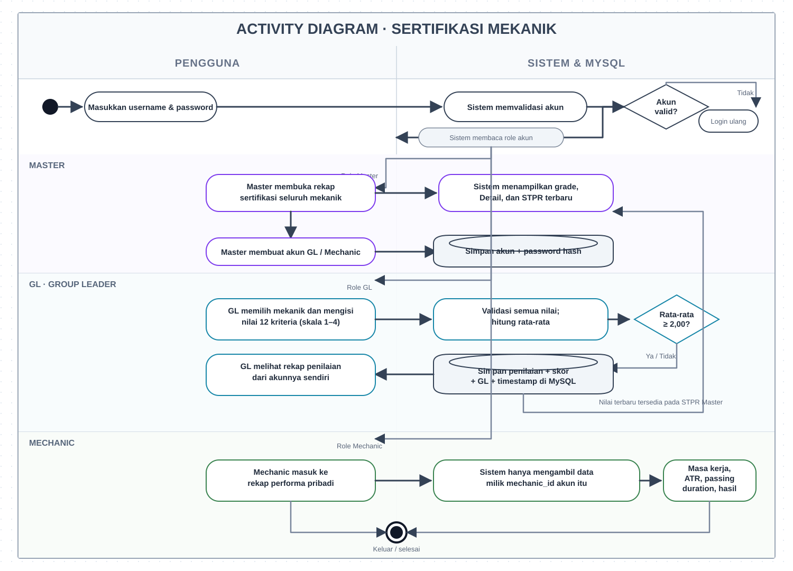
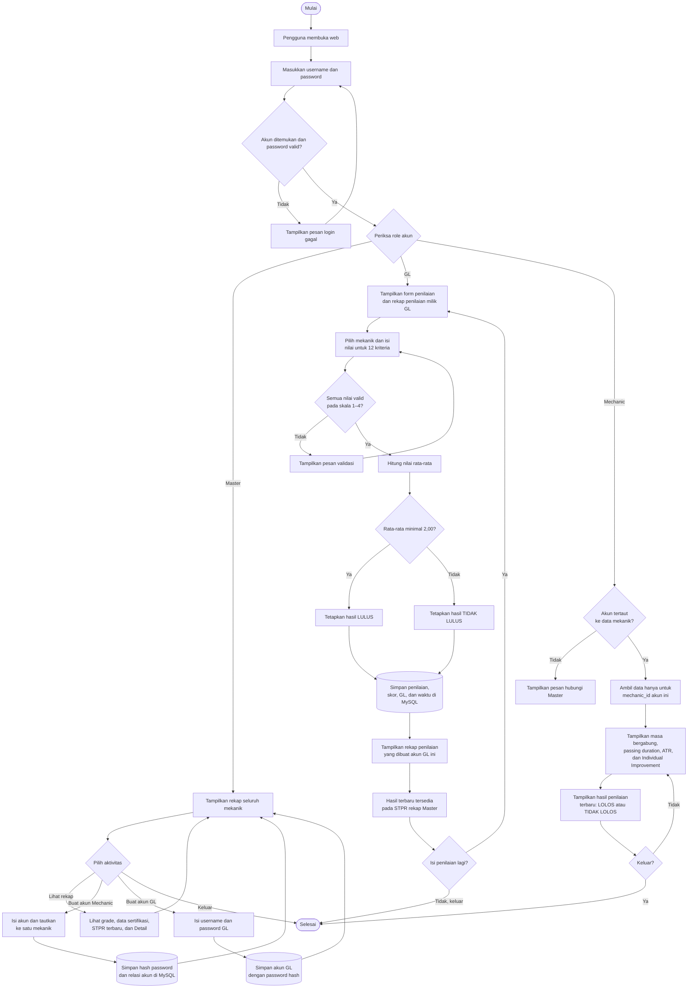

# Activity Diagram — Sistem Sertifikasi Mekanik

## Aturan akses

- **Master** melihat rekap semua mekanik dan dapat membuat akun Mechanic/GL. Form penilaian dan riwayat penilaian tidak ditampilkan untuk Master.
- **GL** mengisi form penilaian dan melihat rekap yang dibuat dari akunnya sendiri.
- **Mechanic** hanya melihat data profil dan hasil penilaian miliknya sendiri.
- Hasil GL menjadi nilai STPR terbaru pada rekap Master. Passing grade penilaian adalah rata-rata **2,00 dari 4,00**.
